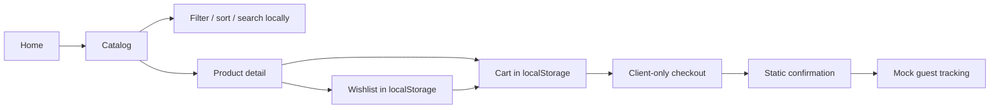
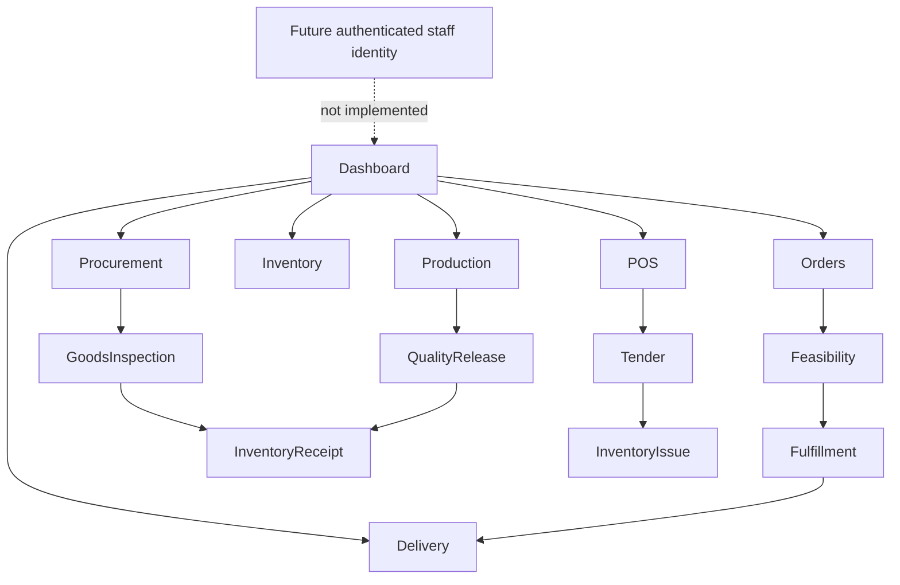
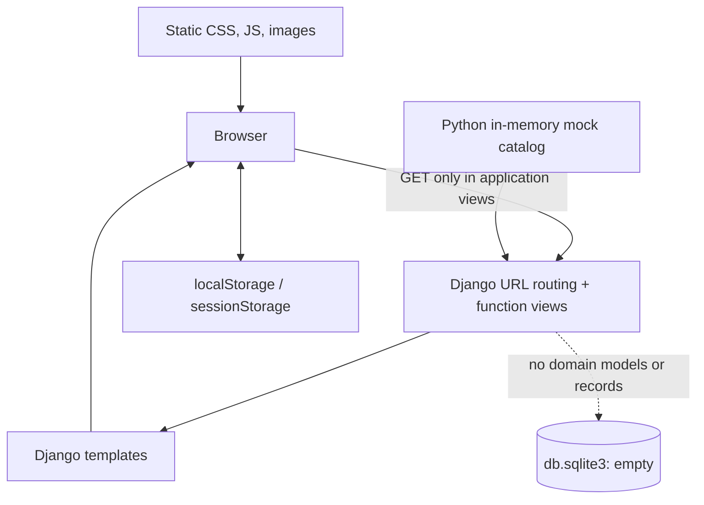
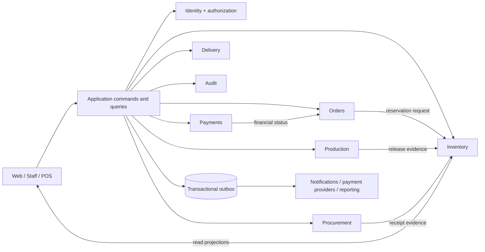

# WayTop Farm — CTO Engineering Audit

**Audit date:** 26 July 2026
**Repository:** `waytop_farm`
**Scope reviewed:** all 505 Git-tracked files, including 113 Python files, 124 templates, 13 JavaScript files, 20 CSS files, 84 Markdown files, static assets, configuration, tests, and the empty SQLite database.

## Evidence standard and limitations

- **Confirmed** means directly supported by repository source or an executed command.
- **Specified** means described in `docs/` but explicitly not implemented.
- **Inferred** is used only where the repository does not provide runtime evidence.
- Static inspection covered all tracked paths. Generated `__pycache__` bytecode and binary image pixels were inventoried but not reverse-engineered; their references, formats, and presence were checked.
- Runtime validation was attempted with `python manage.py check` and `python manage.py test`. Both stopped before Django initialized because Django is not installed and the repository has no dependency manifest. Therefore no claim below treats the test suite as passing.
- No external vulnerability database was queried because there is no pinned dependency set to audit.

## 1. Executive summary

WayTop Farm is a **high-fidelity, server-rendered Django user-interface prototype** for a Kenyan farm/nursery storefront and future operations platform. It demonstrates a 12-product seedling catalog, browser-local cart and wishlist, mock checkout and tracking, plus staff screens for orders, production, inventory, procurement, POS, and delivery. The repository is not an operational commerce or ERP system: virtually every domain model is empty, the database is zero bytes, all domain actions are mock/browser-only, and authentication/authorization is not enforced.

The intended architecture is thoughtful. The documentation separates Orders, Payments, Fulfillment, Production, Inventory, Procurement, POS, Delivery, Audit, and future Accounting; it explicitly protects ledger immutability, independent lifecycles, separation of duties, and propagation-neutral production. Evidence: [business domains](architecture/business-domains.md), [inventory ownership](architecture/inventory-ownership.md), [state machines](architecture/state-machines.md), and [authorization philosophy](architecture/authorization-philosophy.md).

Current maturity is best described as **product/design prototype or pre-alpha**, not an MVP backend. The public catalog and most designed staff pages are useful as interaction specifications. There is no durable ordering, payment, stock, identity, notification, audit, or reporting capability.

### Biggest strengths

- Strong domain-thinking and safety boundaries in the architecture specifications.
- Consistent, accessible-minded UI contracts with explicit loading, empty, error, permission, and offline states.
- Central mock catalog with unique SKUs/assets and good product-content governance.
- Explicit copy prevents prototype actions from being mistaken for real stock, payment, or workflow changes.
- Broad template contract tests cover much of the intended presentation.

### Biggest weaknesses

- No implemented domain data model, migrations, database content, service layer, or write API.
- No real authentication or authorization; all staff screens are publicly routable.
- No dependency manifest, README, environment example, CI/CD, deployment, container, monitoring, backup, or recovery configuration.
- A development secret and `DEBUG=True` are the defaults; production security settings are absent.
- Thirteen view routes render missing templates and are expected to fail.
- Tests are mostly string/markup assertions and cannot currently run from a clean checkout.

### Overall risk assessment

**Critical if treated as production; moderate if treated strictly as a disposable prototype.** The largest business risk is mistaking detailed UI/specification work for implemented operational capability. The largest technical risk is implementing persistence piecemeal behind the screens without preserving the documented ownership, ledger, lifecycle, idempotency, and authorization boundaries.

## 2. Product feature inventory

| Feature | Purpose | Implementation | Status | Dependencies and technical notes |
|---|---|---|---|---|
| Marketing home | Present nursery value proposition and featured products | [core views](../apps/core/views.py), [home template](../templates/core/home.html) | Complete as static UI | Four featured records selected from mock catalog |
| Product catalog | Browse 12 products and four categories | [product views](../apps/products/views.py), [mock data](../apps/products/mock_data.py), `templates/products/` | Complete as prototype | Client-side filter/sort/page; no database or server pagination |
| Search | Find products by name | [search template](../templates/products/search.html), [catalog JS](../static/js/catalog.js) | Partial | Browser-side substring filtering; query is not processed server-side |
| Product detail | Show specifications, guide, related and recent products | [product view](../apps/products/views.py), [detail template](../templates/products/product_detail.html) | Complete as prototype | Related/recent values are deterministic mock records |
| Wishlist | Save products in a browser | [wishlist template](../templates/wishlist/wishlist.html), [commerce JS](../static/js/commerce.js) | Partial | `localStorage`; no account sync, server integrity, or persistence guarantee |
| Cart / mini-cart | Select products and quantities | [cart template](../templates/cart/cart.html), [commerce JS](../static/js/commerce.js) | Partial | `localStorage`; caps quantity at 99 but does not validate stock |
| Checkout | Collect contact, fulfillment, and payment preference | [checkout template](../templates/orders/checkout.html), [checkout JS](../static/js/checkout.js) | Partial / non-operational | Client validation and session preview only; creates no order/payment/reservation |
| Confirmation | Preview submitted request | [success template](../templates/orders/success.html) | Mock only | Static customer/order details plus `sessionStorage` preference |
| Guest tracking | Preview lookup and order timeline | [tracking template](../templates/orders/tracking.html), [tracking JS](../static/js/order-tracking.js) | Mock only | No backend lookup, tokens, throttling, or order data |
| Staff overview | Show operational metrics, tasks, alerts, activity | `templates/dashboard/` | Complete as UI prototype | Hard-coded presentation; explicitly says no records change |
| Staff order management | List/detail and independent status projections | `templates/dashboard/orders*`, [dashboard views](../apps/dashboard/views.py) | Mock only | No Order/Fulfillment/Payment/Return models or commands |
| Production | Source lots, batches, tasks, exceptions | `templates/dashboard/production/` | Mock only | Excellent propagation-neutral specification; no data or transitions |
| Inventory | Items, lots, movement ledger, receipts, transfers, counts, adjustments | `templates/dashboard/inventory/` | Mock only | No immutable ledger, transactions, reservations, or balances |
| Procurement | Suppliers, requests, POs, receiving, performance | `templates/dashboard/procurement/` | Mock only | No supplier records, approvals, three-way matching, or stock handoff |
| POS | Register dashboard, sale, parked sales, transactions, receipts | `templates/dashboard/pos/`, [POS JS](../static/js/staff-pos.js) | Mock only | Local DOM cart; no tender, register session, inventory, receipt, or accounting event |
| Delivery | Dashboard, jobs, job detail and local status preview | `templates/dashboard/delivery/`, [delivery JS](../static/js/staff-delivery.js) | Mock only | Browser-local simulated status; no dispatch or proof of delivery |
| Staff UI permissions | Demonstrate capability-filtered navigation/states | [staff JS](../static/js/staff.js), architecture docs | Partial demonstration | Client-side hiding is explicitly not enforcement |
| Accounts | Login, registration, profile routes | [account views](../apps/accounts/views.py) | Broken / unused | Templates missing; no form processing; Django auth URLs not used |
| Blog | Blog and article routes | [blog views](../apps/blog/views.py) | Broken / unused | Templates missing; no content models |
| Branches | Branch page route | [branch view](../apps/branches/views.py) | Broken / unused | Template missing; catalog branch availability is mock data |
| Contact | Contact page route | [contact view](../apps/contact/views.py) | Broken / unused | Template missing; no form/email workflow |
| Reviews | Review page route | [reviews view](../apps/reviews/views.py) | Broken / unused | Template missing; no review model/moderation |
| Payments | Payment route | [payments view](../apps/payments/views.py) | Broken / unused | Template missing; no provider integration |
| Notifications | Notification route | [notifications view](../apps/notifications/views.py) | Broken / unused | Template missing; no delivery channel/queue |
| About / FAQ | Informational routes | [core views](../apps/core/views.py) | Broken | Both templates missing |
| Django admin | Framework administration | [root URLs](../config/urls.py) | Framework route only | No registered domain models; access depends on undeployed Django auth DB |

## 3. User flows

### Implemented browser prototype flows

1. **Discovery:** home → categories/shop/search → product detail → related/recent products.
2. **Wishlist:** product toggle → local browser storage → wishlist page → add to cart.
3. **Cart:** add item → mini-cart/cart → change quantity/remove → checkout.
4. **Checkout:** guest selection → contact → delivery/pickup → mock payment choice → review → browser redirect to confirmation.
5. **Tracking:** enter order number and Kenyan phone → client validation → static mock result.
6. **Responsive navigation:** open/close mobile navigation, mini-cart, filter drawer, and staff drawer.

There is no registration-to-purchase flow: the “returning customer” UI says sign-in is future work. There is also no actual payment, inventory reservation, order submission, or notification.

### Specified staff flows (UI only)

- Order triage → availability/feasibility → fulfillment assignment → preparation → quality → dispatch/delivery.
- Source material receipt → production batch → activities/tasks → quality release → inventory receipt.
- Purchase request → approval → purchase order → goods inspection → independent inventory receipt.
- Inventory receipt/transfer/count/adjustment requests → approval where needed → immutable movement posting.
- Register/session → POS cart → tender → sale → receipt; parked/void/refund/return are intended independent workflows.
- Delivery assignment → pickup → in transit → delivered/failed → proof and exception handling.

These flows are specified in `docs/flows/` and projected by templates, but no server-side commands or transitions exist.

## 4. Architecture

### Current architecture

The backend is a thin rendering shell. Root URL configuration includes 13 local apps plus Django admin. Function views either render templates or select from Python dictionaries. There are no controllers/services/repositories beyond these views, no REST/GraphQL API, no AJAX/fetch calls to a backend, and no jobs/workers.

The frontend is server-rendered HTML enhanced by isolated vanilla JavaScript files. Shared catalog data is serialized into the global shell by [the commerce context processor](../apps/core/context_processors.py). Browser state is stored under `waytop-commerce-v1`; checkout and delivery previews use browser storage. CSS is organized into foundation files plus page/domain-specific styles, with no build pipeline.

### Intended modular architecture

The intended dependency direction is documented well, but none of the domain boxes exist as executable modules. The correct next step is a modular monolith with explicit domain services and transactional boundaries, not microservices.

### Data flow

- Public catalog: `mock_data.py` → view/context processor → template/JSON script → client filtering/cart.
- Staff screens: hard-coded template records → optional JavaScript state simulation.
- No client data crosses a trust boundary into application persistence.

## 5. Folder-by-folder breakdown

| Folder | Purpose and key files | Interaction |
|---|---|---|
| `apps/` | Thirteen Django app packages. Each has conventional `apps.py`, `models.py`, `views.py`, `urls.py`, `tests.py`, migrations. | Included by `config/urls.py`; all local model files are empty stubs. |
| `apps/core/` | Homepage, shared contact/catalog context processors. | Depends directly on product mock data and injects it into every template response. |
| `apps/products/` | Catalog source, browse/detail views, strongest test suite outside dashboard. | Supplies public pages and global commerce JSON. |
| `apps/cart/`, `wishlist/`, `orders/` | Rendering endpoints for browser-local commerce prototype. | Depend on shared JavaScript rather than server data. |
| `apps/dashboard/` | 35 staff routes, one 140-line view module, 487-line contract test module. | Renders hard-coded domain templates with a query-string state selector. |
| Other app folders | Placeholder routes for accounts, blog, branches, contact, reviews, payments, notifications. | Mostly broken because corresponding templates are absent. |
| `config/` | Django settings, root URL routing, ASGI and WSGI entry points. | Uses SQLite and environment fallbacks; lacks production split/hardening. |
| `templates/` | 124 Django templates: public shell, commerce, state components, staff workspaces. | Rendered by function views; staff/public base shells load static assets. |
| `static/css/` | 3,464 lines of hand-written design system and page styles. | Loaded directly; no minification, bundling, linting, or preprocessing. |
| `static/js/` | 1,142 lines of vanilla JS in 13 scripts. | DOM enhancement and browser-local state only. |
| `static/images/`, `static/products/` | Branding, hero/category imagery, and unique product WebP images. | Referenced by templates and catalog metadata. |
| `docs/architecture/` | Future domain, identity, authorization, inventory, operation specifications. | Design authority, not executable implementation. |
| `docs/contracts/` | Future command/UI contracts for checkout and staff domains. | Defines boundaries and invariants; no schemas/code generated from them. |
| `docs/flows/`, `docs/frontend/` | Interaction and screen-level specifications. | Closely aligned with current templates. |
| `docs/reviews/` | Historical phase audits. | Useful provenance but repetitive and not a substitute for current release gates. |
| `docs/catalog/` | Governed master catalog document. | Contract-tested against `mock_data.py`, creating two sources that must be synchronized. |
| `db.sqlite3` | Configured development database. | Zero bytes; no project migrations or domain tables. |

Absent folders/configurations include dependency management, `README`, `.gitignore`, `.env.example`, CI workflows, Docker, infrastructure-as-code, server configuration, scripts, jobs, workers, package/build configuration, API schemas, and operational runbooks.

## 6. API and endpoint audit

### API conclusion

There is **no machine API**. The repository declares 59 application endpoints plus Django admin (60 total). All application routes below accept GET and return HTML. No application view checks the method, parses a body, validates a schema, authenticates a user, or returns structured errors. Dynamic product/category misses raise 404; most arbitrary staff identifiers render a static page. Missing templates produce server errors when reached.

All routes have `Authentication: none`, `Input: path/query only`, `Output: HTML`, and `Consumers: browser/templates`. The `?state=` query is not allowlisted and is reflected into HTML attributes through Django escaping; it is a demo-state selector, not a domain input.

| Method | Path(s) | View / status |
|---|---|---|
| GET | `/` | Home, working prototype |
| GET | `/about/`, `/faq/` | Broken: missing templates |
| GET | `/accounts/login/`, `/accounts/register/`, `/accounts/profile/` | Broken and non-functional |
| GET | `/products/` | Shop |
| GET | `/products/categories/` | Category index |
| GET | `/products/category/<slug>/` | Category filter; unknown slug → 404 |
| GET | `/products/search/?q=` | Search page; filtering occurs in browser |
| GET | `/products/<slug>/` | Product detail; unknown slug → 404 |
| GET | `/cart/`, `/wishlist/` | Browser-local commerce pages |
| GET | `/orders/checkout/`, `/orders/success/`, `/orders/track/`, `/orders/history/` | Mock commerce/tracking pages |
| GET | `/payments/` | Broken: missing template |
| GET | `/branches/` | Broken: missing template |
| GET | `/blog/`, `/blog/article/` | Broken: missing templates; article has no identifier |
| GET | `/reviews/`, `/contact/`, `/notifications/` | Broken: missing templates |
| GET | `/dashboard/` | Publicly accessible staff overview |
| GET | `/dashboard/orders/` | Static order list |
| GET | `/dashboard/orders/<order_number>/` | Static detail; accepts any string |
| GET | `/dashboard/production/` | Production dashboard |
| GET | `/dashboard/production/source-lots/` | Static source lots |
| GET | `/dashboard/production/batches/` | Static batches |
| GET | `/dashboard/production/batches/<batch_number>/` | Static batch detail; accepts any string |
| GET | `/dashboard/production/tasks/` | Static tasks |
| GET | `/dashboard/production/exceptions/` | Static exceptions |
| GET | `/dashboard/inventory/` | Inventory dashboard |
| GET | `/dashboard/inventory/items/` | Static item list |
| GET | `/dashboard/inventory/items/<item_code>/` | Static detail; accepts any string |
| GET | `/dashboard/inventory/lots/` | Static lots |
| GET | `/dashboard/inventory/movements/` | Static movement ledger projection |
| GET | `/dashboard/inventory/receiving/` | Static receiving form |
| GET | `/dashboard/inventory/transfers/` | Static transfer form |
| GET | `/dashboard/inventory/counts/` | Static counts |
| GET | `/dashboard/inventory/adjustments/` | Static adjustment requests |
| GET | `/dashboard/procurement/` | Procurement dashboard |
| GET | `/dashboard/procurement/suppliers/` | Static suppliers |
| GET | `/dashboard/procurement/suppliers/<supplier_code>/` | Static detail |
| GET | `/dashboard/procurement/requests/` | Static purchase requests |
| GET | `/dashboard/procurement/requests/<request_number>/` | Static detail |
| GET | `/dashboard/procurement/orders/` | Static purchase orders |
| GET | `/dashboard/procurement/orders/<order_number>/` | Static detail |
| GET | `/dashboard/procurement/receiving/` | Static inspection/receiving |
| GET | `/dashboard/procurement/performance/` | Static mock reporting |
| GET | `/dashboard/pos/` | POS dashboard |
| GET | `/dashboard/pos/sale/` | Browser-only sale simulation |
| GET | `/dashboard/pos/parked/` | Static parked sales |
| GET | `/dashboard/pos/transactions/` | Static transactions |
| GET | `/dashboard/pos/transactions/<reference>/receipt/` | Static receipt |
| GET | `/dashboard/delivery/` | Delivery dashboard |
| GET | `/dashboard/delivery/jobs/` | Static jobs |
| GET | `/dashboard/delivery/jobs/<delivery_number>/` | Static job detail |
| Framework | `/admin/` | Django admin; no domain models registered |

**Dead/broken endpoints:** 13 rendered templates are missing: accounts login/register/profile; blog/blog and blog/article; branches; contact; core about/FAQ; notifications; payments; reviews. The admin route has no registered local models. API documentation, versioning, pagination contracts, schemas, idempotency semantics, and consistent error envelopes are all absent because an API does not yet exist.

## 7. Database audit

### Confirmed present state

- Database engine: SQLite, configured in [settings](../config/settings.py).
- Database file: `db.sqlite3`, zero bytes.
- Project domain tables: none.
- Project model classes: none; every local `models.py` contains only the generated placeholder.
- Project migrations: only empty `__init__.py` files.
- Relations, indexes, constraints, duplicate/unused models: none to assess.
- Django built-in auth/session/admin tables would exist only after installing Django and running migrations.

### Required target data architecture

Do not turn every screen noun into an editable table. Start from the ownership map in `docs/architecture/`. Core needs include catalog/products, customers/addresses, orders/lines/status events, payments/attempts/refunds, fulfillment/delivery, production source lots/batches/activities/releases, procurement suppliers/requests/POs/inspections, inventory items/lots/locations/movements/reservations, POS registers/sessions/sales/tenders, identity assignments/delegations, and audit/outbox records.

Critical database properties:

- Foreign keys and uniqueness for SKU, order/reference numbers, provider references, and idempotency keys.
- Append-only status/movement/payment/audit histories; reversals instead of destructive edits.
- Optimistic version or row locking on command aggregates.
- Composite indexes matching tenant/branch scope, status queues, due dates, and ledger lookup patterns.
- Decimal monetary values and explicit units; never floating-point money.
- Database constraints for non-negative quantities where semantically valid, balanced movement entries, and independent lifecycle states.
- PostgreSQL for production; SQLite only for disposable local development.

## 8. Authentication and authorization audit

Authentication is **not implemented** in application flows. Django’s middleware and built-in auth app are enabled, but account views merely render missing templates and do not call `authenticate`, `login`, or `logout`. There are no JWTs, refresh tokens, custom users, login forms, password reset, verification, MFA, or session policy.

Authorization is **not enforced**. No view has `login_required`, permission decorators/mixins, object-scope checks, or policy calls. Every staff URL is public. JavaScript and `data-capability` attributes simulate roles, while the documentation correctly says hidden navigation is not security.

Cookies would use Django defaults because secure/HTTP-only/SameSite/session age settings are not explicitly governed. CSRF middleware exists, but current application forms do not submit to application write endpoints. Before any write path is introduced:

- Adopt server-side sessions for the Django staff/web monolith.
- Define a custom user model before first real migration.
- Implement staff status, role assignments, branch/location/register scopes, delegation, separation of duties, and object-level policy.
- Require authorization at query and command boundaries, not templates.
- Add MFA for privileged staff, password reset, lockout/rate controls, session rotation, secure cookies, inactivity/absolute expiry, and audit events.

## 9. Frontend audit

### Strengths

- Clear server-template composition and reusable public/staff page-state partials.
- Semantic headings, skip link, ARIA status/alert usage, focus management, and keyboard-aware drawers are visible throughout.
- Responsive styles exist across public and staff modules.
- Catalog records and commerce serialization are centralized rather than repeated in each template.
- Dynamic HTML in commerce/checkout is generally passed through explicit `escapeHtml`.

### Risks and gaps

- State management is ad hoc browser storage. It has no synchronization, expiry, schema migration, privacy boundary, cross-device behavior, or authoritative stock validation.
- Search, filters, pagination, cart totals, and checkout validation run only in JavaScript; no progressive server fallback exists.
- Some JS assumes required DOM elements exist and can throw if template markup drifts.
- The context processor serializes the complete catalog on every rendered template, including staff pages, increasing payload and coupling.
- `setTimeout`-driven loading states add artificial latency.
- No CSP-compatible script strategy, module system, TypeScript, linting, formatting, unit test harness, browser E2E test, or bundle analysis.
- Accessibility is design-intent only; there is no automated axe/WCAG or assistive-technology evidence.
- Hard-coded operational/customer examples appear throughout staff templates and must never become a persistence strategy.
- Thirteen routes have no template at all.
- Mojibake sequences are visible in captured source/output (`’`, `×`, etc.), indicating an encoding normalization issue worth checking in browsers and editors.

## 10. Backend audit

There are no controllers/services/repositories in the usual layered sense. Function views are simple render adapters. Business logic is limited to catalog selection/enrichment and formatting a phone number. There is no validation of server commands, logging, caching, queue, cron job, worker, transaction, integration, webhook, file upload, email, or domain error handling.

The largest file, [dashboard views](../apps/dashboard/views.py), contains repetitive render functions. This repetition is low-risk in a prototype but should not evolve into business logic. When backend implementation begins, introduce application command/query services per domain, transaction boundaries, policy enforcement, structured domain errors, and an outbox for side effects.

## 11. Security audit

| Severity | Confirmed finding | Impact | Evidence / recommendation |
|---|---|---|---|
| Critical | Staff operations URLs have no authentication or authorization | Exposure and future broken access control if real data/actions are connected | [dashboard views](../apps/dashboard/views.py); put staff namespace behind deny-by-default policy before persistence |
| Critical | App is not deployable reproducibly | Unknown dependencies and untestable security posture | No requirements/lock file; add pinned manifest and supported Python/Django matrix |
| High | Insecure default secret key and `DEBUG=True` | Secret compromise and sensitive debug disclosure on misconfigured deployment | [settings](../config/settings.py); fail closed when production env is selected |
| High | No production HTTPS/cookie/HSTS/proxy/security-header configuration | Session theft, downgrade, framing/content policy gaps | [settings](../config/settings.py); add environment-specific security settings and CSP |
| High | No authorization model exists for branch/location/register scoped operations | Broken object-level authorization risk | [authorization contract](contracts/authorization.md); implement policy tests before commands |
| High | No throttling/abuse protection is designed into login, tracking, checkout, or payment entry points | Enumeration, credential attacks, spam, cost abuse | Add per-IP/account/device and provider-safe rate controls |
| Medium | Browser storage holds cart/wishlist and preview data without lifecycle policy | Shared-device leakage and tampering | [commerce JS](../static/js/commerce.js), [checkout JS](../static/js/checkout.js); treat as untrusted and avoid sensitive data |
| Medium | No CSP, permissions policy, referrer policy, or explicit content-type hardening | Increased XSS/exfiltration blast radius | Add middleware/header tests; eliminate inline-script blockers |
| Medium | Dependency vulnerability status is unknowable | Supply-chain exposure | No manifest; pin, hash where practical, automate updates/scanning |
| Medium | No audit logging or immutable event trail | Fraud/incident investigations impossible | Implement actor, scope, correlation, before/after references and append-only audit |
| Low | Arbitrary `state` values and arbitrary staff object IDs render generic pages | Confusing behavior and weak input contracts | Allowlist demo state; real object lookups must 404 without scoped access |
| Low | No `.gitignore`; tracked bytecode and zero-byte DB pollute source | Accidental secrets/runtime artifacts may be committed later | Add ignore policy and repository secret scanning |

OWASP mapping: broken access control is the dominant future risk; security misconfiguration is confirmed; vulnerable/outdated component status is unknown; identification/authentication, logging/monitoring, and SSRF protections are absent because their features do not yet exist. No confirmed SQL injection or server-side XSS sink was found: there are no raw queries and Django auto-escaping is used. This does not reduce the need for server validation when writes/APIs arrive.

## 12. Performance audit

Current scale is small and no database/API latency exists. Accordingly, N+1 queries, cold starts, memory leaks, and database plans cannot yet be measured.

Confirmed concerns:

- Entire catalog JSON is injected globally on all template responses.
- Product filtering/paging renders all 12 cards first; acceptable now, not scalable.
- Many unminified CSS files and page scripts are served without a build/optimization pipeline.
- Some CSS files are large (`home.css` 583 lines, `navbar.css` 428); staff pages load base plus domain styles.
- Static file production serving, compression, cache-control fingerprints, CDN, and image delivery policy are not configured.
- Artificial 180–220ms timers delay catalog/checkout rendering.
- No caching layer or cache invalidation design exists.

Preserve the simple stack until evidence requires complexity. Add server pagination/search, selective catalog serialization, WhiteNoise or object/CDN static delivery, compression and immutable hashes, query-count tests, and observability before introducing distributed caches.

## 13. Code quality audit

Repository text volume is approximately: Python 1,628 lines, templates 1,983, JavaScript 1,142, CSS 3,464, and Markdown 4,589. The system contains more specification than executable Python.

Strengths include clear naming, intentionally small views, product contract tests, modular CSS/JS by page, and unusually explicit domain-boundary prose.

Issues:

- 13 near-empty Django apps generate surface area without capability.
- `dashboard/views.py` repeats the same state/render pattern 35 times.
- `dashboard/tests.py` is 487 lines and mostly tests static strings, making copy edits expensive.
- Dense one-line templates reduce reviewability and produce misleading line metrics.
- Catalog facts exist in both Markdown and Python and require synchronization tests.
- Magic demo IDs, dates, amounts, people, quantities, and states are embedded in templates/JS.
- No formatter/linter/type checker/template linter is configured.
- No type annotations or schema definitions for catalog dictionaries.
- Compiled Python cache files are tracked.
- Historical phase documents create documentation duplication and can obscure the actual implementation boundary.

No reliable cyclomatic complexity or duplication percentage can be claimed without a configured toolchain. The principal complexity today is specification/UI breadth, not algorithms.

## 14. Technical debt register

| Priority | Problem | Impact | Effort | Suggested fix |
|---|---|---|---|---|
| P0 | No reproducible environment | Cannot run/check/release | S | Add `pyproject.toml`/lock, supported Python, install/test commands |
| P0 | Public staff routes | Critical access-control architecture failure | M | Custom user + session auth + deny-by-default scoped policies |
| P0 | No persisted domains | Product cannot transact | XL | Implement vertical slices, starting identity/catalog/order foundation |
| P0 | Unsafe production defaults | Misdeployment can expose debug/secret | S | Environment settings, required secrets, security checks |
| P0 | 13 missing templates | Wired endpoints fail | S | Remove unused routes/apps or build minimal intentional pages |
| P1 | No CI | Regressions undiscovered | S | Check, tests, lint, migration drift, security scan |
| P1 | No database migrations/schema | No durable source of truth | XL | PostgreSQL schema based on ownership contracts |
| P1 | Browser-only checkout | False sense of order completion | L | Server-validated idempotent order command |
| P1 | No audit/outbox | Unsafe operational and integration changes | L | Append-only audit plus transactional outbox |
| P1 | No tests below templates | Business invariants unprotected | L | Model/service/policy/integration tests |
| P1 | No observability | Failures and fraud invisible | M | Structured logs, metrics, traces, error reporting, alerting |
| P1 | No deployment/backups | Cannot operate or recover | M | Repeatable deploy, managed DB, backup/restore drills |
| P2 | Global catalog serialization | Waste/coupling | S | Inject only on commerce pages or expose cached query |
| P2 | Hard-coded mock records | Duplication and drift | M | Fixtures/factories for demo mode; database projections for real mode |
| P2 | Dense templates and giant contract test | Poor maintainability | M | Format templates, data-driven tests, componentize repeated cards |
| P2 | No frontend tooling/tests | JS/accessibility regressions | M | ESLint/Prettier, Vitest or equivalent, Playwright + axe |
| P2 | Encoding artifacts | Unprofessional/corrupted copy risk | S | Normalize UTF-8 and enforce editor/lint policy |
| P3 | Many placeholder apps | Cognitive overhead | S | Delete/defer apps until a bounded feature is funded |
| P3 | Documentation duplication | Onboarding ambiguity | M | Mark canonical docs, archive phase reviews, maintain decision records |

Effort: S < 2 engineer-days, M 3–10 days, L 2–6 weeks, XL multi-month.

## 15. Dependency audit

No `requirements.txt`, `pyproject.toml`, Pipfile, Poetry file, lockfile, JavaScript package manifest, or vendored manifest exists. Django 5.2 is mentioned in generated ASGI/WSGI comments, but that is not a dependable version declaration. The local interpreter is Python 3.14.6 and lacks Django.

Therefore unused, outdated, vulnerable, duplicated, and heavy packages cannot be measured. The browser frontend uses no declared third-party library. Recommended baseline:

- Pin a supported Python release and current supported Django line in `pyproject.toml`.
- Lock transitive versions; separate runtime/dev dependencies.
- Add PostgreSQL driver, production WSGI/ASGI server, static serving, structured logging, and test/lint tools only as needed.
- Run automated dependency and secret scanning in CI.
- Avoid adding DRF, Celery, Redis, or a SPA framework until a concrete API/background workload requires them.

## 16. Testing audit

There are 80 discovered test methods. Most are `SimpleTestCase` render-contract assertions. Coverage percentage is unavailable because neither dependencies nor coverage tooling exist, and tests could not initialize.

What is tested well:

- Catalog identity, unique assets/SKUs, and category counts.
- Presence of public/staff UI sections and demo page states.
- Some evidence-safe copy and separation-of-domain wording.
- Unknown product/category 404 behavior.

Critical missing tests:

- Authentication, session lifecycle, roles, scopes, delegation, and every object-level access rule.
- Models, constraints, migrations, transactions, concurrency, idempotency, and ledger balancing.
- Order/payment/inventory/production/procurement/POS/delivery state machines.
- Server form/schema validation and malicious inputs.
- Provider/webhook replay, signature, retry, and reconciliation behavior.
- Integration and end-to-end purchase/staff flows.
- JavaScript unit tests and storage corruption/migration behavior.
- Accessibility, cross-browser, responsive visual regression, performance, and security headers.
- Deployment smoke, backup restoration, and disaster recovery.

There is no evidence of flaky tests because there is no executable test run. There is also no coverage configuration or threshold.

## 17. DevOps audit

No Dockerfile, Compose file, CI/CD workflow, Procfile, infrastructure-as-code, environment example, secrets integration, reverse proxy, cloud manifest, monitoring, logging configuration, alert definition, backup policy, deployment script, or disaster-recovery runbook exists.

ASGI and WSGI entry points are standard Django scaffolding. Static/media settings are development-only. There is no production database, object storage, TLS policy, health/readiness endpoint, release migration strategy, rollback procedure, or environment separation.

Minimum operating model:

1. Reproducible container or documented build with pinned dependencies.
2. CI gates for formatting, lint, Django checks, migrations, tests, security and secret scans.
3. Staging and production environment settings with managed PostgreSQL and secret manager.
4. Zero-downtime-compatible migrations, health/readiness checks, immutable releases, and rollback.
5. Structured application/security/audit logs, error tracking, metrics and alerts.
6. Encrypted backups with retention and quarterly restore drills; documented RPO/RTO.

## 18. Production readiness scores

| Area | Score / 10 | Rationale |
|---|---:|---|
| Architecture | 4 | Strong specification; executable architecture is only render views |
| Security | 1 | Public staff screens, unsafe defaults, no authz |
| Performance | 4 | Small/simple prototype, but no production delivery or measurement |
| Reliability | 1 | No durable workflows, retries, recovery, or runtime reproducibility |
| Observability | 1 | No logging/metrics/tracing/alerts |
| Maintainability | 5 | Clear UI organization/docs, but placeholders and duplication |
| Scalability | 2 | In-memory catalog, browser state, SQLite |
| Developer experience | 2 | No README, dependencies, env example, automation, or CI |
| Testing | 3 | Broad markup contracts, no executable environment or domain tests |
| Deployment | 1 | No deployment/infrastructure configuration |
| **Overall** | **2 / 10** | **Not production-ready; valuable pre-alpha specification/UI prototype** |

## 19. Prioritized roadmap

### Phase 1 — Critical (immediate, 0–4 weeks)

| Priority | Item | Effort | Impact / dependency / outcome |
|---|---|---:|---|
| P0 | Declare prototype status and block public deployment | S | Prevents business misuse; outcome is honest release posture |
| P0 | Add README, dependency lock, env example, `.gitignore`, CI | S–M | Enables repeatable checks; prerequisite for all implementation |
| P0 | Remove or repair 13 broken routes | S | Eliminates known 500s |
| P0 | Split development/production settings and fail closed | S | Prevents debug/secret misconfiguration |
| P0 | Decide bounded first release and canonical domain docs | M | Stops UI breadth from driving uncontrolled backend work |
| P0 | Design custom user, scoped authorization and audit primitives | M | Prerequisite to connecting any staff data/action |

### Phase 2 — High priority (30–90 days)

| Priority | Item | Effort | Expected outcome |
|---|---|---:|---|
| P1 | PostgreSQL schema + migrations for identity, catalog, customer, order core | L | First durable source of truth |
| P1 | Session auth, staff lifecycle, role/scope enforcement, policy tests | L | Secure staff foundation |
| P1 | Server-side catalog/search/cart validation and idempotent order creation | L | Real guest order-request MVP |
| P1 | Payment abstraction with one provider sandbox, signed webhooks and reconciliation | L | Safe payment lifecycle independent of order |
| P1 | Audit log and transactional outbox | L | Traceability and reliable side effects |
| P1 | Integration/E2E test harness and staging | M | Release confidence |
| P1 | Logs, errors, metrics, health checks, backups and restore test | M | Operable service |

### Phase 3 — Medium (next quarter, 3–6 months)

- Implement fulfillment and delivery vertical slice.
- Implement inventory item/lot/location/movement ledger with receipt and reservation commands.
- Connect production quality release and procurement receiving through evidence-driven inventory receipts.
- Build notifications through outbox consumers.
- Add admin/support tools, exports with scope enforcement, accessibility testing, performance budgets, and reconciliation dashboards.
- Pilot at one branch with least-privilege roles and operational training.

### Phase 4 — Long-term (6–12+ months)

- POS registers/sessions/tenders and offline conflict strategy.
- Returns/refunds and inspected stock-return workflow.
- Procurement approvals, quotations and three-way matching.
- Production scheduling/cost projections and advanced traceability.
- Reporting warehouse/projections; future Accounting integration.
- Multi-branch scale, DR exercises, SLOs, capacity tests, and security review.

Dependencies flow from identity/audit → catalog/orders → payments/fulfillment → inventory → production/procurement/POS. Do not reverse this order by wiring staff buttons directly to tables.

## 20. Quick wins under one day

- Add a top-level README stating “frontend prototype; no orders/payments/stock are persisted.”
- Add `.gitignore` and stop tracking bytecode/database runtime artifacts.
- Add `pyproject.toml` with pinned Django/dev tools and a one-command test workflow.
- Add `.env.example` without secrets.
- Fail startup in production if `SECRET_KEY`, hosts, or database settings are absent.
- Remove broken URL entries or add intentional “not implemented” pages.
- Allowlist `state` demo values.
- Normalize files to UTF-8 and fix visible mojibake.
- Move commerce catalog injection to commerce pages only.
- Add a basic CI workflow for Django check/test and formatting.
- Add a repository status table linking canonical specs versus implemented modules.

## 21. Refactoring opportunities

- Replace 35 repetitive dashboard render functions with a small explicit render helper only while pages remain prototypes; preserve named views where authorization policies will differ.
- Move hard-coded staff examples into structured demo fixtures so templates express layout rather than datasets.
- Break one-line staff templates into reviewable components.
- Convert catalog dictionaries to typed dataclasses/schema validation or, once persistence begins, ORM projections.
- Generate catalog documentation from one canonical source instead of synchronizing Markdown and Python manually.
- Split `dashboard/tests.py` by domain and replace large string lists with reusable semantic contract helpers.
- Load catalog JSON and scripts only where required.
- Archive phase-review documents after extracting decisions into ADRs and canonical architecture docs.
- Delete placeholder apps/routes until there is an owned feature; empty modularity is not architecture.

## 22. Documentation gaps

The repository has rich product/domain documentation but lacks operational documentation:

- No root README or new-developer onboarding.
- No dependency/install/run/test commands.
- No environment variable reference or `.env.example`.
- No implemented architecture document that contrasts current versus target state.
- No API/OpenAPI documentation.
- No database schema/ERD or migration policy.
- No threat model, data classification, privacy/retention policy, incident response, or security runbook.
- No deployment, rollback, monitoring, alert, backup, restore, RPO/RTO, or disaster-recovery documentation.
- No contribution, branching, release, versioning, support, ownership, or ADR process.
- No browser/accessibility support matrix.

The existing `docs/project-governance.md` and architecture files should remain inputs, but each canonical document needs an owner, status, decision date, and implementation link.

## 23. Final CTO report

### 1. What has already been built?

A polished public catalog/commerce interface prototype, an extensive set of staff operations screens, a centralized 12-product mock catalog, browser-local cart/wishlist/checkout simulations, 80 presentation-contract tests, and detailed future-domain specifications.

### 2. What works well?

The visual architecture, domain language, state coverage, product content, separation-of-duty intent, inventory ownership rules, and explicit “mock only” boundaries. Preserve these concepts as acceptance criteria.

### 3. What is incomplete?

Almost all server-side product capability: persisted users/customers/catalog/orders/payments/inventory/production/procurement/POS/delivery, real authentication/authorization, integrations, notifications, reporting, deployment, observability, and recovery. Thirteen routes are immediately broken by missing templates.

### 4. What is risky?

Treating the UI as a working system; exposing staff screens; deploying unsafe defaults; accepting real customer/payment data without durable, idempotent, auditable workflows; and letting tables or screens blur documented domain ownership.

### 5. What should never be changed casually?

- Independent Order, Payment, Fulfillment, Return, Production, and Inventory lifecycles.
- Inventory movement/audit immutability and reversal semantics.
- Procurement/Production evidence handoff rather than direct stock mutation.
- Branch/location/register scoping and separation of duties.
- Propagation-neutral production (seed, rootstock, scion, cuttings, etc.).
- Explicit money/unit handling and idempotent external integration boundaries.

Any change to these needs an architecture decision record and invariant tests.

### 6. What should be rewritten?

Checkout/tracking/POS/delivery logic must be implemented as server-validated application workflows; the current JavaScript is useful only as interaction reference. Account views, settings organization, and domain persistence need real implementations rather than incremental patches to placeholders.

### 7. What should be deleted?

Remove unused/broken placeholder routes/apps unless scheduled, tracked `__pycache__` files and runtime DB artifacts, duplicate obsolete phase documentation after archiving, artificial loading timers, and any mock customer/transaction data that could appear in a real environment.

### 8. What should be built next?

A secure, observable vertical slice: reproducible environment → custom identity and scoped authorization → PostgreSQL catalog/customer/order schema → server-side guest order request → audit/outbox → one payment sandbox → fulfillment projection. Keep scope to one branch and one sales channel initially.

### 9. Biggest business risks

- Stakeholders overestimating completion because the prototype is visually comprehensive.
- Accepting orders or payments that cannot be reconciled, fulfilled, or recovered.
- Inventory inaccuracies causing overselling, waste, or fraud.
- Inadequate privacy/security controls for customer and staff data.
- Attempting all documented domains simultaneously and exhausting delivery capacity.

### 10. Biggest technical risks

- Broken access control and absent object scoping.
- No transactional/idempotent command boundaries.
- No immutable audit/inventory/payment histories.
- No reproducible build, deployment, observability, or recovery.
- Domain coupling introduced by implementing screens directly against shared tables.

### 11. Recommended 3-, 6-, and 12-month roadmap

- **3 months:** reproducible engineering baseline, security settings, custom identity/authorization, PostgreSQL foundation, catalog/customer/order request MVP, audit/outbox, staging, CI/E2E, monitoring/backups.
- **6 months:** payment reconciliation, fulfillment/delivery, inventory ledger and reservations, controlled production/procurement handoffs, one-branch operational pilot.
- **12 months:** hardened POS, returns/refunds, procurement approvals, production traceability, reporting projections, multi-branch scale, SLOs, DR/security exercises.

## Go/no-go recommendation

**No-go for production or real customer transactions.**
**Go for continued user research and architecture validation**, provided every environment is visibly labeled as a prototype and contains no real operational or sensitive data. Production consideration should require all Phase 1/2 P0/P1 controls, executable acceptance tests for domain invariants, and a successful backup/restore plus security review.
